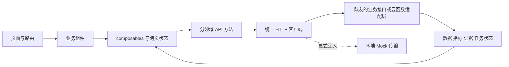

SME-I Manager 项目分析与组件开发方案

本方案依据《中小型企业经济智慧管理工具软件设计报告 v6》正文、图 5-1 系统功能结构图、图 5-2 业务流程图，以及用户提供的角色设定和九张 Web 界面参考图整理。组件方案针对当前 Vue 3 + Vite 工程。文中“报告要求”代表原文；“建议”代表为落地开发补充的设计，不表示已经实现。

本文面向前端负责人。你负责页面、组件、响应式样式、交互状态、输入校验、API 调用与联调。账单解析、持久化去重、指标计算、AI 工具编排、预警评估、权限判定和真实备份由队友的服务端提供。下文涉及这些能力时，表达的是前端需要的接口结果和联调条件，不要求你实现后端逻辑。

全部模块都预留接口，但严格区分说明书的 MVP 与扩展阶段。HTTP 路径、字段和状态是联调草案，说明书没有规定 REST 协议；队友使用云函数时，可通过统一接口适配，组件不应直接绑定云厂商 SDK。

核心产品目标是帮助小微经营者解释经营结果。完整业务链为：数据采集 → 校验与分类 → 确认入账 → 服务端指标计算 → 图表展示与 AI 解释 → 预警处理 → 回查和修正数据。

**需求来源与实施范围。** 报告强调低门槛、低成本和经营解释能力，目标用户包括餐饮店、奶茶店、便利店、小型零售商与个体服务经营者。其产品范围不包含完整 ERP、库存供应链或专业税务申报系统。

| 事项 | 报告依据 | 开发安排 |
| --- | --- | --- |
| 六大业务模块 | 5.1：数据采集、记账管理、经营分析、智能问答、预警提醒、系统管理 | 统一导航与领域划分；首页是额外的工作台入口 |
| 一期终端 | 5.5、6.2：微信小程序 + 云函数 + 云数据库 | 这是报告的产品分期；当前 Vue 工程承接 Web 方案 |
| 桌面端 | 5.5：第二阶段提供 PC 客户端或网页、深度报表与导出 | 当前截图体现完整 PC 方向；先做 Web 演示属于实施顺序调整 |
| MVP | 6.3、8.1：手工录账、账单导入与自动分类、基础指标报表、智能问答、试用优化 | 先交付贯通的数据闭环 |
| 扩展 | 8.1：OCR、主动预警、账号权限与备份、多端报表与导出 | 设计保留完整边界，分阶段开发 |
| AI 原则 | 5.3、6.4：系统算数，模型解释 | 模型调用指标和查询工具，数值与证据由服务端提供 |
| 成本控制 | 8.2：缓存分析结果、控制上下文长度 | 基于数据版本缓存分析，限制工具调用与历史消息长度 |

报告把完整成员权限放在扩展阶段，不意味着 MVP 可以跳过基础身份认证、经营主体隔离和服务端访问控制。后续可扩展为老板、会计、店员的权限模型。

**原型中需要先统一的内容。** 不应把截图里的数字和成功提示直接写成业务逻辑。

| 原型问题 | 核对结果 | 建议处理 |
| --- | --- | --- |
| 毛利、利润、收支结余混用 | 128400 − 82150 = 46250，但截图的成本包含房租、人工等项目，口径未定义 | 先确定经营指标字典；仅有支付流水时优先展示收支结余；完整成本口径建立后再展示相应利润指标 |
| 环比不一致 | 分析页营业额 +5.2%；问答页 128400 对比 135200，实际约 −5.03% | 全页面从同一演示数据集、同一指标接口读取 |
| 百分比表述 | 39.1% 到 36.0% 是下降 3.1 个百分点 | 比率差异和相对变化使用不同字段与单位 |
| 单品毛利数据不足 | 支付流水未必包含商品销量与实际成本 | 商品售价与成本价仅能算参考单件毛利；真实期间毛利还需销售行与成本记录 |
| 自动分类与入账混淆 | 486 = 452 + 34 只是分类结果 | 分开显示识别行数、重复行数、无效行数、待确认行数、已入账数 |
| 预警占比分母不明 | 成本结构图的 45% 可能是原材料/总成本，预警也可能想表达原材料/营业收入 | 规则必须明确分母与比较周期，界面展示完整名称 |
| 品牌与布局不统一 | 各图 Logo、侧栏宽度、图标、激活色不一致 | 统一 Logo、图标集、AppShell、导航与设计变量 |
| 无依据的成功提示 | “已推送至微信”“已核对”“已备份”是示例画面 | 只有真实状态与服务端结果才能触发这些提示 |

涉及存货的情况下，采购付款与当期已售商品成本需要区分。IAS 2 对存货售出时确认相关费用的说明可用来理解这一差异，本项目仍需根据自身经营管理范围确定口径，不把简化管理报表宣称为法定财务报表。[IFRS IAS 2 说明](https://www.ifrs.org/issued-standards/list-of-standards/ias-2-inventories/)

**前端架构与接口边界。** 页面依赖统一领域 API，组件不直接调用数据库或模型。Web、小程序共用数据和分析接口，但不假设 Vue DOM 组件与小程序组件可以直接复用。可共享的是字段契约、校验规则、指标定义、文案和部分无平台依赖的逻辑。



服务端可按报告部署在云函数体系中；Web 通过适配后的统一接口访问。模型密钥、账单解析、去重、写入校验、指标计算、规则执行与租户权限都放在服务端。采用哪家云服务应以实际项目约束为准，不能仅凭文件路径推断。

现有项目只安装 Vue 与 Vite 相关依赖。当前前端框架用浏览器 History API 处理页面路径、Vue 响应式状态管理查询上下文、原生 SVG/HTML 绘制基础图表，并采用 CSS Variables 与统一的 `src/styles/app.css` 组织样式；没有引入新依赖。接口类型放在 `.d.ts` 契约文件中供编辑器检查。若后续复杂路由、共享状态或图表交互达到现有实现难以维护的程度，再经过团队确认与依赖验证考虑 [Vue Router](https://router.vuejs.org/guide/)、[Pinia](https://pinia.vuejs.org/core-concepts/)或 [Apache ECharts](https://echarts.apache.org/handbook/en/concepts/event/)，这些不是说明书规定的必选技术。

建议目录如下，表达职责划分，不要求一次创建全部文件：

```text
src/
  app/                 # 启动配置、路由、全局状态装配
  layouts/             # PublicLayout、AppShell
  components/
    ui/                # Button、Input、Select、Dialog、Drawer、Toast
    shared/            # MoneyText、KpiCard、EvidenceLink、MascotAssistant
  features/
    landing/           # 对外介绍页
    overview/          # 功能总览、首次使用引导
    ingestion/         # 导入、字段映射、预览、OCR
    ledger/            # 流水、成本归集、分类、商品
    analytics/         # 指标、趋势、结构、对比
    assistant/         # 会话、回答、证据、追问
    alerts/            # 预警实例、规则、通知状态
    settings/          # 成员、备份、导出、审计
  composables/         # 可复用界面逻辑
  services/            # HTTP 客户端与各领域接口
  stores/              # 登录身份、查询上下文、任务状态
  domain/              # 类型、枚举、指标定义与格式化契约
  styles/              # tokens、reset、layout、utilities
  assets/mascot/       # 分场景透明角色资源
```

**组件边界。** 页面负责组合模块和协调请求，业务组件负责领域交互，基础组件负责一致的界面行为。不要用一个带几十个开关的万能 Card 代替清晰的组件职责。

| 层级 | 组件 | 责任 |
| --- | --- | --- |
| 应用框架 | AppShell、AppHeader、SideNav、MobileNav、PageHeader | 当前入口、店铺/周期上下文、导航收起、路由内容 |
| 基础交互 | BaseButton、TextInput、MoneyInput、DateRangePicker、Select、Dialog、Drawer | 键盘操作、校验呈现、忙碌状态、焦点管理 |
| 基础反馈 | EmptyState、ErrorState、Skeleton、Toast、ConfirmDialog | 区分无数据、筛选无结果、失败与加载 |
| 通用展示 | SectionCard、KpiCard、ChartPanel、DataTable | 分别处理容器、指标、图表与表格的不同状态 |
| 领域组件 | TransactionForm、CategorySelect、SourceBadge、MoneyText、EvidenceLink | 复用业务字段、金额格式、来源追溯 |
| 引导组件 | MascotAssistant、OnboardingChecklist | 根据真实业务状态给出帮助与引导 |

| 关键组件 | 输入 | 输出或事件 | 边界 |
| --- | --- | --- | --- |
| KpiCard | value、unit、comparison、direction、favorability、quality、loading | drilldown | direction 表示涨跌，favorability 表示业务影响，不能直接以正负决定红绿 |
| BillDropzone | accept、maxSize、disabled、jobState | selectFiles、retry、cancel | 浏览器初检；服务端仍需验证格式和内容 |
| TransactionForm | modelValue、mode、categories、errors、submitting | update:modelValue、submit、cancel | 手工录入和 OCR 确认共享字段，不各写一套规则 |
| DataTable | rows、columns、sort、pagination、selection、loading | sortChange、pageChange、selectionChange、rowOpen | 金额右对齐、筛选分页由页面协调 |
| ChartPanel | title、query、loading、error、quality | refresh、drilldown | 图表实例与生命周期由图表封装维护 |
| AnswerCard | answer、evidence、querySnapshot、status | inspectEvidence、followup、export | 结论与指标引用分开建模 |
| MascotAssistant | scene、state、message、compact | dismiss、openHelp | 只反映业务状态，不决定业务是否成功 |

**页面与组件开发范围。** 以下路由是 Web 建议；票据识别和商品分类是业务子页面，避免无限增加一级导航。

| 页面与路由 | 组件拆分 | 主要交互 |
| --- | --- | --- |
| 介绍页 `/` | PublicHeader、HeroSection、BenefitList、MascotIllustration | 开始使用根据登录状态跳转；功能链接定位介绍；示例数字标为演示数据 |
| 登录与首次配置 `/login`、`/onboarding` | LoginForm、BusinessProfileForm、FirstImportGuide | 登录回跳、行业与经营主体配置、引导首笔录账；截图未展示但闭环需要 |
| 功能总览 `/app/overview` | ModuleCard、OnboardingChecklist、RecentImport、PendingTasks | 六模块跳转，首次用户进入导入，老用户看到待确认和近期记录 |
| 数据采集 `/app/ingestion` | BillDropzone、FileList、ImportProgress、MappingEditor、ImportPreview、ImportSummary、TransactionForm | 选择/拖拽文件、校验、识别列、预览、去重、分类、确认入账 |
| 票据识别 `/app/ingestion/receipts/:id` | ReceiptPreview、OcrFieldEditor、ConfidenceBadge、ReceiptConfirmBar | 放大旋转、重新拍摄、修正字段、查重、确认入账；扩展阶段 |
| 记账管理 `/app/ledger` | KpiCard、LedgerFilterBar、LedgerTable、TransactionDrawer、BatchCategoryBar | 筛选、排序、分页、查明细、新增修改、批量分类与作废 |
| 商品与分类 `/app/ledger/products`、`/app/ledger/categories` | ProductTable、ProductEditor、CategoryTree、CategoryEditor、CostAllocationEditor | 维护商品售价/成本、分类、成本归集；商品期间利润需实际销售数据 |
| 经营分析 `/app/analytics` | PeriodSelector、MetricDefinitionPopover、RevenueTrendChart、CostBreakdownChart、ComparisonTable | 日周月切换、对比期切换、联动筛选、图表点击下钻 |
| 智能问答 `/app/assistant` | ConversationList、MessageList、ChatComposer、AnswerCard、EvidencePanel、SuggestedQuestion | 提问、计算、生成、停止/重试、看证据、追问、生成报告 |
| 预警提醒 `/app/alerts` | AlertTabs、AlertCard、AlertDetailDrawer、RuleEditor、NotificationStatus | 看明细、标记已读、处理、忽略、恢复、保存规则；扩展阶段 |
| 系统管理 `/app/settings` | MemberTable、RoleEditor、InviteDialog、BackupJobCard、ExportDialog、AuditLog | 成员管理、备份任务、导出范围、下载、操作记录；高级管理属扩展阶段 |

首页的六模块卡片保持轻量，但建议增加实际待办。仅提供六个入口不能帮助用户判断今天先处理什么。公开介绍页的大标题与角色插图可保持参考风格；业务页优先保证表格和图表空间。

**账单导入的核心逻辑。** 一期支持用户主动导入导出的文件，不把它描述成已经接入微信或支付宝实时账单 API。格式支持清单应依据真实样本确定，前端 accept 提示不能代替解析器能力。

```text
idle → selected → validating → uploading → parsing → review → committing → completed
                    ↘ failed       ↘ failed   ↘ failed          ↘ failed
```

状态转换由真实请求和任务结果驱动。上传字节进度、服务端解析阶段、确认入账进度分别展示；不知道总量时使用不确定进度，不用定时器伪造百分比。

1. 选择文件后检查大小、扩展名与可读性；服务端再次检查实际内容、编码、列名、日期与金额格式。CSV 和表格文件分别走解析适配器，保留原始来源与解析版本。
2. 解析到暂存区，显示原始行、标准字段、疑似重复、格式错误与分类建议。识别失败时允许用户映射列，而不是导入错位数据。
3. 分类先匹配明确规则与历史映射，再补模型建议；模型分类也只允许落在已有分类集合。低置信度和未知项进入人工确认。
4. 核对结果按“无效、重复、可确认、待处理”等互斥集合统计，确保总数可核对。自动分类成功不是已入账。
5. 明确确认范围；建议默认只提交有效且已确认的行。待处理项留在暂存区。若支持合法未分类流水入账，则独立标记 categoryStatus，并明确其对分类报表的影响。
6. 用“经营主体 + 平台 + 来源账户 + 平台交易标识”做可靠去重；退款使用自身标识并关联原交易。无可靠标识时，指纹只产生疑似重复提示，不能把同时间同金额的两笔合法交易直接丢弃。
7. 提交携带 idempotencyKey，重复点击和网络重试返回同一次提交结果。大批量可分块处理，但每行结果与已提交范围必须可追溯，失败重试不能再次入账。
8. 成功后增加数据版本，刷新流水与相关指标；“查看待处理”跳到当前批次筛选结果，“查看已入账”跳到账本。保留导入历史、错误行和修正入口。

**手工录账与流水维护。** 表单包含经营日期、收支方向、业务类型、金额、分类、摘要和可选商品/票据。金额输入与存储统一规则：金额为正的最小货币单位，方向单独存储，界面负责展示正负号。不要同时接受负金额与“支出”而导致重复取反。

保存流程为“字段校验 → 提交中禁用重复保存 → 服务端校验与权限检查 → 写入 → 返回实体和数据版本 → 更新列表与指标”。失败保留输入；离开有未保存修改的表单时给出保存/放弃选择。批量分类显示选择范围，分页选择不能悄悄扩大到所有数据。编辑采用 revision 或其他版本检查处理并发修改；作废保留原记录和操作原因，详情中展示来源、关联票据和变更记录。

转账、提现、支付平台结算、借款、老板投入等不默认当作营业收入；退款应关联原交易并在约定期间冲减。手续费若从结算款扣除，要依据账单字段说明还原或标注口径，避免将净到账额误当含手续费前的销售额。缺少识别依据时进入待确认。

**票据识别的核心逻辑。** 这是扩展能力，状态建议为 `selected → uploading → recognizing → review → committing → posted`，每个异步阶段都有失败重试。图片与识别结果并列展示，允许放大、旋转和重新识别。识别字段共享 TransactionForm 的金额、日期和分类校验。

服务实际返回字段置信度时才展示；没有置信度不能固定写 98%。阈值应可配置并通过样本验证，低置信字段需要用户重点复核，金额和日期始终明确可编辑。识别完成只是草稿，点击确认且服务端成功才生成交易。用文件哈希、票据标识和关联记录提示潜在重复，并考虑同一支出既有支付流水又有票据的情况：优先关联已有流水作为凭证，而不是重复记一笔费用。OCR 的识别过程不应自动推断票据一定属于经营成本。

**经营分析的核心逻辑。** 页面共享如下查询上下文：经营主体、门店（如支持）、起止日期、时区、日/周/月粒度、对比方式、指标口径与数据版本。门店可作为预留字段，第一版默认单店，不必同时开发复杂多店管理。

切换日期后，一次协调刷新 KPI、趋势、成本结构和对比表。取消旧请求或按请求序号丢弃过期响应，防止快速切换时旧结果覆盖新结果。日期范围、分类与分页等适合分享的条件放入 URL；敏感原始流水不放入 URL。

每张图必须显示单位、时间范围、图例和必要刻度。参考图中的平滑曲线只是视觉示意，实际图表使用真实聚合点，是否平滑取决于是否会造成误读。收入蓝、成本橙、利润青的系列颜色固定；业务好坏用独立的趋势状态表达。点击成本环图扇区打开相同期间和分类的流水，点击趋势点打开对应日期明细。

当前基础趋势图使用响应式 SVG viewBox，图表区域随容器伸缩，数据行可点击查看证据。若将来经团队确认改用图表库，要让容器先具有尺寸再初始化，在侧栏收起、证据栏展开等容器变化时 resize，并在卸载时销毁实例。[ECharts 事件](https://echarts.apache.org/handbook/en/concepts/event/) [ECharts 容器尺寸](https://echarts.apache.org/handbook/en/concepts/chart-size/)

缺少同期数据展示“暂无可比数据”；零值与缺失值区别处理；上期为零不显示 Infinity；利润跨越零点或基期为负时优先展示绝对差额与“扭亏/转亏”等经过规则确认的表述。本月尚未结束时，默认对比上月相同天数，并明确标签，也允许用户切换整月比较。

**智能问答的核心逻辑。** 推荐受约束的工具调用流程：问题理解 → 解析指标与期间 → 检查权限与数据覆盖 → 调用确定性计算工具 → 生成证据快照 → 模型组织解释 → 校验引用 → 展示回答。用户提问独立触发流程，不要求先存在异常。

```text
idle → submitting → querying → calculating → generating → completed
          ↘ error      ↘ needs_clarification / insufficient_data
                                        generating → stopped / error
```

模型可用工具例如 getMetricSummary、comparePeriods、getCostBreakdown、listTransactionEvidence。工具由服务端验证参数、时间范围和经营主体权限；不允许模型传入任意 SQL、任意 URL 或跨主体标识。MVP 的问答工具以只读查询为主，模型建议不会自动修改账本或预警规则。

回答结构建议为：结论、计算出的主要变化、相关证据、可能原因、建议动作。解释确定性数值变化与推断现实原因要分开。例如数据能够说明“原材料支出增加”，没有价格和数量证据时不能断言“供应商涨价”或“采购浪费”。

数值、同比环比和变化贡献由工具返回；回答引用 metricId/evidenceId。固定指标卡由前端用工具结果渲染，模型只补文字。服务端验证引用是否存在、展示数值是否与快照相符，发现不符重新生成或降级为确定性摘要。

“看细节”打开对应证据流水；“对比上月”更改本轮明确的对比条件；“出报告”基于同一数据快照创建导出任务。保存每轮问题的查询上下文、数据版本、指标口径版本、证据引用和生成时间。账目修改后旧回答保留“基于某时数据”的说明，并提供更新分析入口。

发送时禁用空消息。Web 输入框建议 Enter 发送、Shift+Enter 换行，输入法组合期间不触发发送；手机提供明确发送按钮。支持停止、失败重试、建议追问与消息历史。用户滚动阅读旧消息时不要强制拉回底部。证据优先显示，生成文字的流式区域应限制在可信结构内渲染；附件与账单备注仅作为数据，不作为模型指令。模型超时时仍展示已计算指标及可重试入口。

**预警提醒的核心逻辑。** 将规则、触发事件、处理状态和通知状态分开。规则包含指标、分母、比较方式、窗口、方向、阈值、连续次数、最小样本量与启用状态；“原材料/总成本 > 40%”和“原材料/营业收入 > 40%”是两条不同规则。

滑块与数值输入双向同步，编辑产生草稿，点击保存后才形成生效版本。保存时提示规则适用范围，并可预览历史命中情况；是否重新评估既往期间必须明确。连续两周超标需要按两个完整周窗口计算，不能由前端根据当前一笔数据写死文案。

预警状态为 open、acknowledged、resolved、ignored；已读与已解决分别维护。查看明细带上触发时的指标快照；忽略只影响该事件，暂停规则是另一动作。指标回归正常或数据修正后，按规则更新状态并保留历史。通过规则版本、经营主体、窗口和事件键去重，设置合理冷却期，避免刷新就再次提醒。通知区分未发送、提交成功、失败和平台可确认的送达状态，不把任务已提交伪装成用户已收到。“无流水”只能提示可能漏记，要考虑休息日和营业日配置。

**系统管理的核心逻辑。** 建议权限矩阵从老板、会计、店员三种模板开始，但具体权限由产品需求确定，不能由截图中的称呼推断。老板管理成员与导出，记账权限按范围授予，敏感汇总按需开放；服务端在每个接口执行授权，前端隐藏按钮只改善体验。

邀请具有待接受、过期、撤销状态，提交前展示授权范围。备份和导出都是异步任务：queued → running → succeeded / failed。用户选择期间、字段与格式后创建导出，完成后提供有有效期的下载入口。Excel/CSV 导出处理可能被识别为公式的文本；PDF 以可阅读的报表模板生成，不截取整个管理页面。加密导出只有实际具备该能力才显示已加密。

备份成功必须以服务端确认备份对象与校验结果为依据，不能只改一个“上次备份时间”。完整方案补充恢复检查、保留策略、失败重试与恢复演练；恢复会改变数据，需要预览影响范围、检查权限并记录审计。报告提到的数据删除能力应有明确主体、范围和操作确认，不能隐藏在普通编辑动作中。

**前端数据对象与接口契约。** 报告明确提出用户、交易记录、成本项、商品/服务、经营指标五类实体；以下是支撑参考界面所需的建议补充。这些是前端 DTO 与逻辑对象，不约束队友的数据库表结构或 ORM。

| 实体 | 最小字段与约束 |
| --- | --- |
| Business、Membership | 主体 ID、行业、币种、时区、用户、角色；用户与经营主体分开 |
| Transaction | 主体、业务日期、方向、业务类型、金额、分类、来源、postingStatus、categoryStatus、revision |
| SourceRecord | 来源账户/平台、外部交易号、原始行、解析版本、批次；可追溯 |
| ImportBatch、ImportRow | 文件指纹、阶段、行结果、错误原因、确认状态、幂等键 |
| Category、ClassificationRule | 分类范围、名称、启用状态、匹配条件、规则版本 |
| CostAllocation | 关联交易、归属期间、成本类别、分摊额；从同一账务事实归集，不能重复加总 |
| Product、SalesLine | 商品信息、参考售价成本；实际销售行保留数量、折扣、退款和历史成本依据 |
| MetricSnapshot | 查询范围、币种、指标数值、比较值、质量说明、数据版本、口径版本 |
| Conversation、Message | 会话范围、问题、回答、状态、证据引用、快照版本 |
| AlertRule、AlertEvent | 规则版本、指标、窗口、阈值、事件键、触发证据、处理状态 |
| Receipt、OcrJob | 原图、字段、置信度（若有）、修订、关联交易、识别状态 |
| ExportJob、BackupJob | 范围、版本、阶段、结果、完成时间、有效期 |
| AuditEvent | 操作者、时间、操作对象、变更、结果 |

API 草案固定使用 amountMinor 十进制整数字符串表示分，例如 "12850" 表示 128.50 元；方向单独存储，金额为正。队友可在服务端选择合适的精确存储类型，但跨端字段格式保持一致。前端统一金额格式化，不把已格式化的“¥128,400”反向解析用于计算。利率与金额不同单位分别建字段；统一舍入规则。业务日期与事件时间戳分开，报表依据主体时区与已定义的业务日期。

当前前端契约中的指标总览形状如下；这是联调草案，不能当作已实现的服务端响应。`dataVersion`、`snapshotId` 等属于成功响应的 `meta`，指标定义和证据引用由服务端返回：

```ts
type MetricSummary = {
  query: {
    startDate: string
    endDate: string // 不含当天
    timezone: string
    granularity: 'day' | 'week' | 'month'
    comparison?: 'previous_period' | 'previous_year' | 'custom'
  }
  metrics: Array<{
    id: string
    label: string
    value: string | null
    unit: 'currency_minor' | 'ratio' | 'percentage_point' | 'count'
    definition: { basis: string; formula: string }
    quality: 'complete' | 'partial' | 'unavailable'
    evidenceId?: string
  }>
}
```

服务端必须从登录身份核对 businessId，不信任前端传入的主体 ID。质量 complete 仅表示已约定数据范围和校验要求满足，不能声称用户所有真实经营活动都已被记录。

| 接口能力示意 | 用途 |
| --- | --- |
| POST /imports；GET /imports/:id；GET /imports/:id/rows | 建立导入任务、读取阶段与行结果 |
| POST /imports/:id/commit | 明确行范围、确认版本和幂等键后入账 |
| GET/POST /transactions；PATCH /transactions/:id | 查询、新建、带 revision 的修改 |
| POST /transactions/:id/void | 作废并保留原因与审计 |
| GET /analytics/summary；GET /analytics/evidence/:id | 统一指标查询及受权限限制的来源追溯 |
| POST /assistant/conversations/:id/messages | 提问、计算与生成，返回消息状态 |
| POST /receipts；POST /receipts/:id/confirm | OCR 草稿与确认入账/关联 |
| GET /alerts；PATCH /alert-rules/:id | 预警实例与规则版本维护 |
| POST /exports；POST /backups；GET /jobs/:id | 异步任务与结果查询 |

分页、过滤、错误格式、请求 ID、权限校验和幂等行为应全局一致。不要让每个页面自定义一套返回结构。以上接口的路径是建议，不是报告给定的 API。

**状态管理与缓存。** 当前跨页查询上下文由 `App.vue` 的 Vue 响应式状态保存，并同步到 URL；业务页面保留各自的表单与请求状态。若未来引入 Pinia，Store 只保存确实需要跨页面共享的身份、主体/期间、侧栏偏好、进行中的导入任务及会话概要。弹窗开关、单个表单的输入、局部 hover 留在组件；无需把所有输入都放进全局 Store。

指标、流水等远程数据统一由 services/composables 管理缓存与失效。建议缓存键至少含主体、查询条件、口径版本和数据版本。写入成功后使受影响周期的缓存失效，再拉取新快照。AI 历史回答保留旧快照，不自动改写；导出和预警也保留其基于的版本。退出登录或切换主体时清理相应内存缓存，避免短暂显示上一个主体的数据。浏览器本地偏好可保存，完整真实账本不以 localStorage 作为唯一数据库。

**CSS 与视觉规范。** 实际运行样式在 `src/styles/app.css`，由 `src/style.css` 引入；同目录 `sme-i-ui-reference.css` 是设计基线示例，未直接接入应用。现有实现用 CSS Variables 统一颜色、间距和圆角，以 `.app-shell`、`.feature-grid`、`.kpi-grid`、`.analysis-grid`、`.import-layout` 和 `.chat-layout` 建立 Grid 布局，以 `.toolbar`、`.field-row`、`.button`、`.badge`、`.ui-state` 统一组件状态。新业务组件需要独有样式时可使用 Vue `<style scoped>`，其作用域行为见 [Vue 官方说明](https://vuejs.org/api/sfc-css-features.html)。

| 视觉元素 | 建议规格 | 对应 CSS |
| --- | --- | --- |
| 品牌主色 | 蓝 #2475FF，按钮文字对比度优先使用较深蓝 #155EEF | CSS 自定义属性、背景与文字状态 |
| 辅助色 | 薄荷浅底 #E6F8F3、青绿正文 #087F73 | 选中导航、帮助提示、正向状态 |
| 页面与卡片 | 浅灰蓝背景 #F6F8FC、白卡片、浅边框 | background、border、box-shadow |
| 圆角 | 输入 8px、卡片 14px、对话框 18px | border-radius |
| 间距 | 4/8/12/16/24/32px，卡片内边距约 24px | gap、padding、margin |
| 文字 | 页面标题 28–32px、正文 14–16px、指标 30–36px | font-size、font-weight、line-height、clamp |
| 金额 | 右对齐、等宽数字 | text-align、font-variant-numeric: tabular-nums |
| 总体布局 | 顶栏约 72px，桌面侧栏约 208px | Grid、minmax(0, 1fr)、min-width: 0 |
| 工具栏与操作 | 自动换行的横向组 | Flexbox、gap、flex-wrap |
| 表格 | 横向滚动局限于容器，表头可吸顶 | overflow-x: auto、border-collapse、position: sticky |
| 官网装饰 | 少量浅薄荷光晕 | radial-gradient、伪元素 |
| 上传状态 | 拖入时强调边框、校验失败时文字和图标反馈 | border-style: dashed、data-state、focus-within |
| 交互状态 | hover/focus/active/disabled/loading | 伪类、aria-disabled、aria-busy 与真实 DOM 属性 |
| 动效 | 150–220ms，限透明度和小幅位移 | transition、transform、opacity |
| 打印与导出 | 独立报表区域，去掉导航/操作/角色装饰 | @media print；正式 PDF 用报表模板 |

这里的颜色和尺寸是根据参考图提炼的建议值，不是从图中精确采样的设计稿。薄荷色适合背景和装饰，正文使用较深青绿；灰文字、描边按钮与状态标签需检查对比度。不能只靠红绿表达经营好坏，还应带箭头、文字和数字。

Grid 负责区域和列布局，Flexbox 负责单行或可换行的工具条。[MDN Grid 说明](https://developer.mozilla.org/en-US/docs/Web/CSS/Guides/Grid_layout) 所示的二维布局能力适合此类管理界面。业务正文保持自然文档流，仅气泡、小装饰和必要覆盖层使用绝对定位。

| 屏幕范围 | 页面适配 |
| --- | --- |
| ≥1440px | 完整侧栏；内容充足时增加 220–280px 辅助角色区域 |
| 1024–1439px | 完整或收窄侧栏；角色收为小头像；业务区优先 |
| 768–1023px | 图标侧栏配可访问名称与展开入口；图表按空间堆叠 |
| <768px | 导航抽屉或底部主要入口；内容单列；KPI 可两列；表格转关键字段卡片或容器内滚动 |
| ≤390px | KPI 必要时单列；缩减装饰与留白，保留字段和主要操作 |

这些断点是初始建议，最终以组件实际溢出情况调整。手机输入文字至少约 16px、主要触控区域建议至少 44px；弹窗焦点圈定、关闭后返回触发元素，导航抽屉需明确关闭入口。减少动效偏好下关闭角色浮动、缩放与平滑滚动，参考 [MDN prefers-reduced-motion](https://developer.mozilla.org/en-US/docs/Web/CSS/Reference/At-rules/@media/prefers-reduced-motion)。

**角色与图片资产。** 参考图有围裙版和卫衣耳麦版两套形象。建议以围裙版作为主要品牌形象；如采用耳麦版，可限定在智能问答，避免跨页随机变换。Logo、图标、文字、数字和图表独立实现；角色按场景提供透明 PNG/WebP，不能把完整参考图铺成背景来充当页面。

| 角色场景 | 触发依据 | 使用方式 |
| --- | --- | --- |
| welcome | 首次使用或总览空状态 | 引导导入或记一笔 |
| importing | 导入任务进行中 | 简短说明当前阶段 |
| needs-review | 存在待确认行或 OCR 字段 | 提供“去核对”入口 |
| success | 服务端写入成功 | 短时确认，可关闭 |
| analyzing | 指标计算或解释生成中 | 思考状态与文字进度 |
| warning | 有待处理预警 | 关联真实事件，避免持续闪烁 |
| backup-success | 备份任务真实完成 | 显示完成结果与时间 |

桌面可给角色分配独立布局列；窄屏只留头像或帮助按钮。装饰图片 alt 为空，有业务含义的状态在可访问文本中重复表达。角色不能遮挡表格、聊天输入或表单按钮，不能作为错误提示的唯一载体，也不应持续大幅运动影响读数。

**建议开发顺序与验收。** 不给未经团队确认的工期；以可验证的阶段产物安排任务。

下表是联合交付依赖；你的前端任务顺序是：确定契约与示例数据 → API 预留层 → 页面框架与公共组件 → 录账/导入/分析/问答主链路 → 扩展页面 → 真实接口联调。后端尚未就绪时显式使用 Mock 传输，标注演示状态；真实请求失败不能悄悄回退成模拟成功。

| 顺序 | 开发产物 | 通过标准 |
| --- | --- | --- |
| 1 口径和样本 | 指标字典、真实账单样本、统一演示数据集、MVP 清单 | 同一示例在账本、分析、问答页面数值一致 |
| 2 基础框架 | 身份/主体边界、AppShell、路由、设计变量、基础组件 | 导航与窄屏可用，加载/错误/空状态完整 |
| 3 最小录账闭环 | 手工录账、流水列表、详情、分类、保存接口 | 新增/修改能更新对应指标，失败保留输入 |
| 4 导入闭环 | 解析、预览、重复检查、分类复核、幂等提交 | 同一交易不重复入账，错误行可定位 |
| 5 分析闭环 | 统一指标、趋势、结构、周期对比与下钻 | 卡片、图表、明细和计算口径一致 |
| 6 智能解释 | 只读工具、证据快照、回答、停止/重试/追问 | 数值有依据，数据不足时不编造，模型失败不阻断记账 |
| 7 试用与修正 | 商户反馈、真实样本验证、移动端闭环验证 | 按报告验证实际经营者能完成录入到提问 |
| 8 扩展能力 | OCR、规则预警、成员管理、备份恢复、导出、多端 | 每项能力有真实任务结果与异常处理 |

当前若先交付 Vue Web 演示，仍建议按录账 → 导入 → 指标 → 问答的顺序贯通，角色视觉和展示页与之并行完善。报告的小程序一期需要单独实现与验证，Web 响应式不能被直接称为已经完成微信小程序。

前端自测覆盖组件状态、输入校验、请求组装、取消/超时、筛选联动、键盘与响应式。下面是需要和队友共同完成的业务联调验收；Mock 测试不能证明服务端去重、权限隔离或备份恢复已经正确实现：

1. 重复文件、跨文件重复平台交易、重复点击确认均不重复入账；同金额合法不同交易不会误删。
2. 退款、转账、提现、结算、手续费按已确定口径计算；错误金额与日期能定位修正。
3. 修改一笔历史记录后，受影响指标、图表、预警与新 AI 回答一致；旧回答仍可追溯原快照。
4. 无数据、上期为零、历史不足、未分类记录、未结束月份分别正确表达，不制造 0、Infinity 或错误环比。
5. 数据表查询和 AI 工具都不能越过经营主体权限；切换主体不闪现上一主体数据。
6. AI 每个数值可对应证据；缺少销量、客户或价格数据时不把现实原因说成已证实。
7. OCR 未确认不入账，支付账单与票据同一笔支出可关联；低置信字段、识别失败和重复确认有处理。
8. 同一预警重算不重复通知；忽略事件不删除交易；通知状态与实际平台结果一致。
9. 导出与屏幕使用同一查询快照；备份可恢复并核对数据，失败能重试。
10. 键盘、输入法、手机窄屏、长摘要、大金额、加载失败和减少动效偏好下仍可完成主要操作。

本次产物包含需求分析、前端开发拆分、CSS 基线、API 调用框架和前后端联调草案。当前 Vue 工程通过显式演示传输层展示可复算的样本，并预留队友的真实接口；说明书一期的小程序和队友的服务端功能仍需分别实现与联调。
